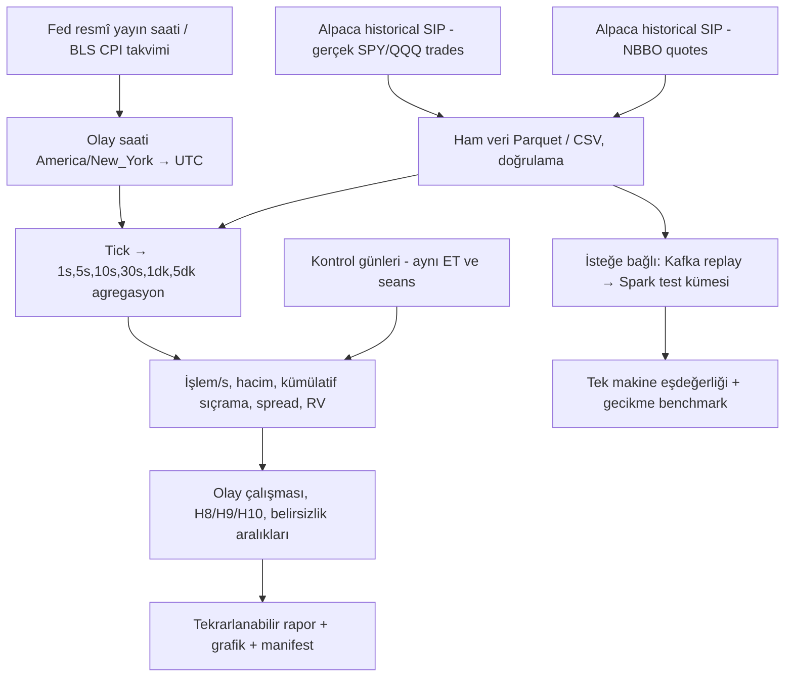

# FED Faiz Kararları ve TÜFE Açıklamalarının S&P 500/Nasdaq-100 Piyasalarında Anlık İşlem Yoğunluğu, Hacim, Kotasyon ve Volatilite Etkisi

### Ücretsiz tarihsel işlem bazlı (tick/prints) ve en iyi alış-satış kotasyonu (NBBO) verisiyle bulut tabanlı olay çalışması


> [!NOTE]
> Bu belge tez/araştırma ön çalışmasıdır; gerçek piyasa sonuçları üretildiği iddia edilmez. Önceki problem/hipotez/literatür bölümleri korunmuş, yöntem bölümü ücretsiz **geçmiş piyasa işlemleri + en iyi alış/satış kotasyon güncellemeleri (NBBO)** için yeniden kurulmuştur. S&P 500 (SPX) ve Nasdaq-100 (NDX) endekslerinin kendisi işlem görmez; bu çalışmada işlem hacmi ve sıklığı **SPY ve QQQ ETF'lerine** aittir. Tüm fiyat kademelerindeki bekleyen emirlerin geçmişini veren **Level 2 / tam emir defteri ücretsiz olarak doğrulanamamıştır**. Ücretsiz veri için hesap uygunluğu ve 15 dakika gecikme koşulları ayrıca test edilmelidir.

---

## İçindekiler

- [1. Problem Tanımı](#1-problem-tanımı)
- [2. Araştırma Soruları ve Hipotez Kurulumu](#2-araştırma-soruları-ve-hipotez-kurulumu)
- [3. Literatür Taraması ve Özeti](#3-literatür-taraması-ve-özeti)
  - [3.1 Duyuru etkisinin zaman yapısı](#31-duyuru-etkisinin-zaman-yapısı)
  - [3.2 Sürpriz bileşeninin ölçülmesi](#32-sürpriz-bileşeninin-ölçülmesi)
  - [3.3 Enflasyon haberleri ve hisse senedi getirileri](#33-enflasyon-haberleri-ve-hisse-senedi-getirileri)
  - [3.4 FOMC ve volatilite: literatürdeki çelişki](#34-fomc-ve-volatilite-literatürdeki-çelişki)
  - [3.5 Bilgisel volatilite / gürültü ayrıştırması](#35-bilgisel-volatilite--gürültü-ayrıştırması)
  - [3.6 Bulut tabanlı dağıtık mimari](#36-bulut-tabanlı-dağıtık-mimari)
  - [3.7 Özet ve tespit edilen boşluklar](#37-özet-ve-tespit-edilen-boşluklar)
- [4. Yöntem: Veri Kaynakları ve Ücretsiz Veri Mimarisi](#4-yöntem-veri-kaynakları-ve-ücretsiz-veri-mimarisi)
  - [4.1 Endeks, ETF, vadeli işlem ve CFD ayrımı](#41-endeks-etf-vadeli-işlem-ve-cfd-ayrımı)
  - [4.2 Ücretsiz veri kaynakları ve kesin kapsamları](#42-ücretsiz-veri-kaynakları-ve-kesin-kapsamları)
  - [4.3 Ham işlem ve kotasyon alanları](#43-ham-işlem-ve-kotasyon-alanları)
  - [4.4 1 saniye–5 dakika işlem yoğunluğu ölçümleri](#44-1-saniye5-dakika-işlem-yoğunluğu-ölçümleri)
  - [4.5 Olay zamanları, CPI premarket ve karşılaştırma grubu](#45-olay-zamanları-cpi-premarket-ve-karşılaştırma-grubu)
  - [4.6 Tamamen ücretsiz kurulum ve örnek komutlar](#46-tamamen-ücretsiz-kurulum-ve-örnek-komutlar)
  - [4.7 Kalite kontrol, sınırlar ve yasak yorumlar](#47-kalite-kontrol-sınırlar-ve-yasak-yorumlar)
  - [4.8 Deney tasarımı ve dağıtık referans mimari](#48-deney-tasarımı-ve-dağıtık-referans-mimari)
  - [4.9 Makroekonomik sürpriz ölçüsü](#49-makroekonomik-sürpriz-ölçüsü)
  - [4.10 Kaynaklar ve erişim doğrulaması](#410-kaynaklar-ve-erişim-doğrulaması)
- [5. Günün Çıktısı ve Yorumu — Güncellenmiş](#5-günün-çıktısı-ve-yorumu--güncellenmiş)
  - [5.1 Bu revizyonda üretilenler](#51-bu-revizyonda-üretilenler)
  - [5.2 Altı temel yorum](#52-altı-temel-yorum)
  - [5.3 Araştırmanın ilerleme sırası](#53-araştırmanın-ilerleme-sırası)
- [Yol Haritası](#yol-haritası)

---

## 1. Problem Tanımı

**Bağlam ve hareket noktası.** Makroekonomik duyurular, hisse senedi piyasasında fiyat oluşumunun en yoğun bilgi kanallarıdır; Fed faiz kararları ile TÜFE açıklamaları bu kanalın en yüksek etkili iki ucunu temsil eder. Yüksek frekanslı verilerle yapılan çalışmalar, fiyat düzeltmesinin büyük kısmının duyurudan sonraki ilk dakika içinde gerçekleştiğini, volatilitenin ise yaklaşık on beş dakika boyunca olağanın belirgin biçimde üzerinde, birkaç saat boyunca da hafifçe yüksek seyrettiğini göstermektedir. Bu, "anlık etki"nin saniye ve dakika ölçeğinde tanımlanması gerektiği anlamına gelir; günlük getirilerle çalışan geleneksel olay çalışmaları bu pencereyi yapısal olarak gözlemleyemez.

**Boşluk (gap).** Literatürün iki kanadı birbirinden kopuktur:

- **Ekonometrik kanat**, duyuru etkisini GARCH türevleri, gerçekleşen volatilite veya sıçrama testleriyle ölçer; ancak hesaplama yükü nedeniyle genellikle tek endeks, kısa örneklem ve tek makine ölçeğinde kalır. Yüksek frekanslı istatistikte temel darboğazın, masaüstü sistemlerin kapasitesini aşan veri hacmi ve optimizasyon yükü olduğu açıkça belirtilmektedir.
- **Veri mühendisliği kanadı**, Kafka/Spark/Flink tabanlı düşük gecikmeli, hataya dayanıklı boru hatlarını ve bulut-yerlisi esnekliğini tartışır, hatta TAQ ölçeğinde mesaj başına 3,6 nanosaniye erişim gecikmesi ve 53 dakikada 11 petabayt düzeyinde analitik tamamlanması raporlanmıştır; fakat bu çalışmalar nedensel-ekonometrik çıkarımı değil, altyapı performansını merkeze alır.

Dolayısıyla **problem**, şu ikisinin aynı sistemde birleştirilmemesidir: (i) duyuru anındaki volatilite sıçramasının ekonomik olarak yorumlanabilir biçimde ölçülmesi, (ii) bunun ücretsiz veri katmanında, olay-zamanı hizalı ve tekrarlanabilir bir dağıtık mimaride üretilmesi. Bu birleşme olmadan, *"TÜFE sürprizi ile Fed sürprizi hangi zaman ölçeğinde, ne büyüklükte ve ne kadar kalıcı bir volatilite yaratıyor?"* sorusu ne istatistiksel olarak yeterince ince, ne de hesaplama olarak yeterince geniş yanıtlanabilir.

### Problem cümlesi

> Fed faiz kararları ve TÜFE açıklamalarının ABD hisse senedi piyasasında yarattığı anlık volatilite tepkisi, sürprizin büyüklüğü, işareti ve duyuru türüne göre nasıl farklılaşır; saniyelik işlemlerin sayısı, toplam pay hacmi, dolar hacmi, işlem başına pay miktarı, NBBO güncelleme sıklığı ve en iyi alış-satış farkı duyuru çevresinde nasıl değişir; bu tepki bilgisel volatilite ile piyasa mikro yapısı kaynaklı gürültüden ne ölçüde beslenir ve söz konusu ölçüm, bulut tabanlı dağıtık bir büyük veri mimarisi üzerinde, ücretsiz veri katmanında ölçeklenebilir ve tekrarlanabilir biçimde nasıl üretilebilir?

### Alt problemler

| # | Alt problem |
|---|---|
| (a) | Olay penceresi tasarımı: duyuru öncesi dönem nereye kadar dahil edilmeli? |
| (b) | Sürpriz ölçüsü: anket medyanına dayalı standartlaştırılmış sapma mı, federal fon vadeli işlem fiyatlamasından türetilen sürpriz mi? |
| (c) | Frekans: 1 saniye, 5/10/30 saniye, 1/5 dakika — yoğunluktaki artış hangi bantta başlar, yükselir, tepe yapar ve söner? |
| (d) | Mimari: akış (streaming) ile mikro-parti (mini-batch) arasındaki denge, gecikme ile istatistiksel doğruluk arasında nasıl kurulur? |

### Sınırlılıklar (baştan yazılması gerekenler)

Zaman damgası hassasiyeti ve saat senkronizasyonu (NTP/PTP) hataları, eşzamanlı açıklanan duyuruların ayırt edilememesi, sıçrama tespitinde yanlış pozitif riski, ve çoklu test problemi — tek bir çalışmada 23 duyuru kategorisi incelenebilmektedir.

---

## 2. Araştırma Soruları ve Hipotez Kurulumu

Aşağıdaki hipotezler, her biri iki yönlü test edilebilir biçimde ($H_0$ / $H_1$) ve ölçüm karşılığıyla kurulmuştur.

| Kod | Hipotez ($H_1$) | Kuramsal / ampirik dayanak | Ölçüm |
|---|---|---|---|
| **H1a** | Fed faiz kararı duyurusu, duyuru sonrası ilk 5 dakikada gerçekleşen volatilitede anlamlı artış yaratır. | Fiyat düzeltmesinin ilk dakikada, volatilitenin on beş dakika yüksek kalması; FOMC günlerinde 14:00 ET'de başlayan 5 dakikalık dilimde ani sıçrama | Olay-zamanı hizalı RV/5 dk; olay kuklası |
| **H1b** | TÜFE duyurusunun etkisi daha kısa ömürlüdür ve faiz kararından daha erken zirve yapar. | Enflasyon duyurusuna tepki ilk 5 dakikada, faiz duyurusuna tepki 15 dakika sonra ve daha uzun süreli | Etki yarı-ömrü (dk); zirve gecikmesi |
| **H2** | Volatilite tepkisi, sürprizin **mutlak büyüklüğü** ile pozitif ilişkilidir. | Sürprizlerin büyüklüğü işaretinden daha önemli; standartlaştırılmış z-tipi sürpriz ölçüsü | $\beta$ katsayısı; RV üzerine regresyon |
| **H3** | Tepki **asimetriktir**: olumsuz/şahin sürprizler, aynı büyüklükteki olumlu sürprizlerden daha büyük ve daha kalıcı volatilite yaratır. | Olumsuz faiz sürprizlerine tepkinin daha uzun sürmesi; negatif şokların daha fazla volatilite üretmesi (kaldıraç etkisi) | İşaret etkileşim terimi; asimetri katsayısı |
| **H4** | Duyuru kaynaklı volatilite artışının bir kısmı **bilgisel**, bir kısmı **gürültü** volatilitesidir; geçmiş NBBO kotasyonlarının bulunduğu dönemlerde en iyi alış-satış farkı ve midpoint, bunların olmadığı durumlarda imza grafiği ve örtük spread proxy'leri kullanılır. | Getiri volatilitesinin imza grafiği ve örtük spread proxy'leri üzerinden ayrıştırılması; tick verisi yerine satıcı barları kullanıldığında gürültünün proxy ile modellenmesi, | İmza grafiği ve örtük spread proxy bileşenleri |
| **H5** | Duyuru etkisi **rejime bağlıdır**; yüksek enflasyon döneminde TÜFE sürprizlerine duyarlılık artar. | 2021–2023 enflasyon dalgasında CPI sürprizlerinin S&P 500, VIX ve diğer varlıklarda daha güçlü etki yaratması | Alt-örneklem / rejim kuklaları; kırılma testi |
| **H6** | Duyuru öncesi pencerede de volatilite ve getiri anomalisi vardır; "anlık etki" yalnızca duyuru sonrası tanımlanamaz. | RV'nin FOMC duyurusu çevresinde sıçraması ve getirinin duyurudan **önce** kazanılması; parasal duyuru günlerinde ön duyuru dikkatinin getiriyi öngörmesi | $t-1$ penceresi; dikkat proxy'si |
| **H7** | Bulut tabanlı dağıtık mimari, tek makine çözümüne kıyasla **aynı tahmin doğruluğunu** daha düşük gecikme ve doğrusal ölçeklenmeyle üretir; veri hacmi tek endeks yerine S&P 500 bileşenleri evrenine genişletilerek simüle edilir. | Kafka/Spark ile düşük gecikmeli, hataya dayanıklı boru hatları; kayan pencere kestirimcilerinin sınırlı bellekle formüle edilebilmesi | Gecikme (ms), işlem hacmi, RV eşdeğerliği ($H_0$: fark yok) |
| **H8** | Duyuru sonrası ilk 1–60 saniyede SPY/QQQ **işlem/saniye** ve **pay/saniye** yoğunluğu, eş saatli kontrol seanslarına göre artar. | Mikro yapı açısından işlem akışındaki kümelenme hipotezi; bu belge ampirik olarak henüz test etmez. | 1s/5s/10s/30s/1dk işlem sayısı, pay hacmi; oran, zirve zamanı, kümülatif hacim |
| **H9** | Duyuru sonrası **NBBO kotasyon güncellemesi/saniye** hızlanır; geçerli kotasyonlarda en iyi alış-satış farkı ve kotasyon büyüklüğü göstergeleri değişir. | Birinci kademe likidite ve fiyat keşfi hipotezi; tüm emir defteri gözlenmez. | Kotasyon güncelleme sayısı, spread (bps), top-of-book dengesizlik proxy'si |
| **H10** | FED ve CPI duyurularında yoğunluğun ilk zirve zamanı ile volatilitenin zirve zamanı farklılaşır. | Duyuruların farklı seanslarda açıklanması ve bilginin fiyat/akışa ayrı hızlarda yansıması. | Tepe gecikmesi (saniye), tırmanma eğimi, sönümlenme yarı-ömrü; seans koşullu karşılaştırma |

### Test stratejisi

Üç katmanlı bir kurgu öneriyorum:

1. **Çok frekanslı mikro yapı olay çalışması** — birincil `[-15,+15)` dakika olay penceresinde ham işlemlerden ve NBBO güncellemelerinden 1s, 5s, 10s, 30s, 1dk, 5dk serileri; ikincil `[-30,+120]` dakika kontrol/kalıcılık penceresi.
2. **İşlem yoğunluğu + volatilite modelleri** — işlem adedi için Poisson/negatif binom veya uygun sayım modeli; volatilite için HAR-RV-X/GARCH-X; kontrol günleri ve sürpriz etkileşimleri.
3. **Kotasyon/işlem sıçrama ayrıştırması** — 1s–5dk örnekleme duyarlılığı, kotasyon güncelleme yoğunluğu, geçerli spread, trade-condition filtreleri ve çoklu test düzeltmesi.

> [!WARNING]
> Çoklu test için Bonferroni/BH düzeltmesi zorunlu; aksi hâlde 23 duyuru kategorisinde rastgele anlamlılık üretilir.

---

## 3. Literatür Taraması ve Özeti

### 3.1 Duyuru etkisinin zaman yapısı

Kurucu katkı, duyuru sonrası fiyat düzeltmesinin çoğunun ilk dakikada tamamlandığını, volatilitenin yaklaşık on beş dakika yüksek kaldığını ve sonraki düzeltmelerin ilk dakika getirisinden bağımsız olduğunu gösterir. Bu asimetri — *fiyat hızlı, volatilite yavaş* — tezin ampirik omurgası olmalıdır. FOMC özelinde Li vd., 2017–2022 döneminde 49 FOMC gününü FOMC'siz günlerle karşılaştırarak 14:00 ET'de başlayan 5 dakikalık dilimde ani ve belirgin bir sıçrama, duyuru sonrasında ise FOMC günleri lehine anlamlı ölçüde yüksek seyreden volatilite tespit etmiştir. Jubinski ve Tomljanovich, 2004–2015 arasında 1.997 getiri ve volatilite serisinde getirilerin duyurulara tepkisiz kaldığını, buna karşılık koşullu volatilitenin her iki duyuru türünde de arttığını ve etkinin duyurudan sonraki 30 dakika boyunca sürdüğünü, kararların tutanaklardan daha güçlü etki yarattığını bulmuştur.

### 3.2 Sürpriz bileşeninin ölçülmesi

Piyasa beklenen değere değil, beklenmedik bileşene tepki verir. Balduzzi vd.'nin önerdiği z-tipi standartlaştırma bu alanda yerleşik hâle gelmiştir. Beber ve Brandt'ın standartlaştırılmış sürpriz ölçüsü, farklı duyuru türleri arasında katsayı karşılaştırmasını mümkün kılar; aynı çalışma duyuru *olayının* at-the-money zımni volatilitede düşüş yarattığını, yani belirsizliğin çözülmesinin zımni volatiliteyi azalttığını göstermiştir. Abasov'un seçilmiş ülkeler analizi, 2007–2016 arasında sürprizlerin *işaretinden* çok *büyüklüğünün* önemli olduğunu ve getiri volatilitelerinin getirilerin kendisinden daha duyarlı olduğunu ortaya koyar.

### 3.3 Enflasyon haberleri ve hisse senedi getirileri

Schwert, 1953–78 dönemi S&P 500 günlük getirilerinde beklenmeyen TÜFE açıklamasına negatif tepki olduğunu, tepkinin verinin toplanmasında değil **açıklama anında** gerçekleştiğini göstermiştir. Adams, McQueen ve Wood ise bu soruyu dakikalar ve işlem sayıları düzeyine indirerek boyut temelli portföylerin PPI ve TÜFE sürprizlerine tepkisini incelemiş; tepkinin hızını, yolunu ve istikrarını sorgulamıştır. Kroner'in güncel katkısı, 2021–2023 enflasyon dalgasında pozitif bir CPI sürprizinin S&P 500'de daha keskin düşüş, VIX'te daha büyük artış ve Euro ile Bitcoin'de daha fazla değer kaybı yarattığını, bunun artan yatırımcı dikkatiyle tutarlı olduğunu göstermektedir.

### 3.4 FOMC ve volatilite: literatürdeki çelişki

Bulgular tek yönlü değildir. Lucca ve Moench, RV'nin 14:15'teki duyuru çevresinde sıçradığını ancak FOMC günü getirisinin duyurudan **önce** kazanıldığını belgeler; Bollerslev, Li ve Liao, S&P 500 için FOMC duyuru zamanlarında anlamlı ani değişimler (sıçramalar) bulur; Onan vd., 23 duyuru kategorisinde VIX üzerindeki etkinin neredeyse her kategoride anlamlı, eğim (slope) üzerinde ise daha sınırlı olduğunu raporlar. Buna karşılık Bajgrowicz vd., 10 saniyelik frekansta sıçrama tespiti yaparak, volatilite patlaması olasılığını artıran **tek** duyurunun hedef Fed fon oranı olduğunu ve sürpriz bileşeninin (standartlaştırılmış sapmanın) hiçbir etkisinin gözlenmediğini bildirir.

> [!IMPORTANT]
> Bu bulgu H2 hipotezi için kritik bir uyarıdır: sürpriz etkisi frekansa, sıçrama tanımına ve sürpriz ölçüsüne aşırı duyarlı olabilir. Bu duyarlılık bir zayıflık değil, *bulgu* olarak raporlanmalıdır.

### 3.5 Bilgisel volatilite / gürültü ayrıştırması

Hautsch, Hess ve Veredas, alım-satım kotasyon getirilerini üç koşullu heteroskedastik bileşene ayırarak haber kaynaklı volatilite artışının ne kadarının bilgisel (etkin fiyatın volatilitesi), ne kadarının kotasyon dalgalanmasından doğan gürültü olduğunu ölçer; gürültü, gözlenen getirinin etkin getiriden sapması olarak modellenir. Bu ayrıştırma olmadan "anlık volatilite etkisi" yorumu, mikro yapı artefaktlarını iktisadi bulgu sanma riski taşır; nitekim koşullu kotasyon getirisi volatilitesinde gürültünün göreli payının ne kadar büyük olduğu ve duyuru çevresinde nasıl değiştiği bu literatürün temel sorularındandır. Andersen ve Bollerslev ise gün içi volatilitenin tek bileşenle açıklanamayacağını, çoklu bileşen (heterojen ARCH) yapısının zorunlu olduğunu ve duyuruların bu bileşenlerden kısa ömürlü olanı beslediğini gösterir.

### 3.6 Bulut tabanlı dağıtık mimari

Kafka/Spark birleşimi, finans sektörünün özel gereksinimlerine yanıt veren ölçeklenebilir, düşük gecikmeli ve hataya dayanıklı boru hatlarının temeli olarak konumlandırılmaktadır; Kafka'nın asenkron mikroservis iletişiminde baskın çözüm olduğu ve tick verisinin 1–8 saniye aralığında akıtılarak 15 dakikalık VaR/ES güncellemeleri için yeniden örneklendiği bir mimari de belgelenmiştir. QuantCloud, SSD destekli veri deposu ve paralel algoritmalarla NYSE TAQ verisi üzerinde mesaj başına 3,6 nanosaniye erişim gecikmesi, saniyede 74 milyon mesaj işleme ve 11 petabayt düzeyinde analitiği 53 dakikada tamamlama performansı raporlar. Ekonometrik tarafta Holý ve Tomanová, çok ölçekli gerçekleşen çekirdek ve ön-ortalamalama kestiricilerini kuadratik formda yazıp bant genişliğini sabitleyerek sınırlı bellekle akış algoritması olarak formüle etmiştir — bu, tezin mimari-ekonometri köprüsünün teknik çekirdeğidir.

### 3.7 Özet ve tespit edilen boşluklar

**Üç noktada birleşme:** etki *hızlı başlar*, *kısa ömürlüdür* ve *sürprize duyarlıdır*.

**Üç noktada ayrışma:**

| Ayrışma ekseni | Karşıt konumlar |
|---|---|
| (1) Sürpriz etkisinin varlığı | Zayıf/kanıtsız bulan çalışmalar vs. güçlü kanıt sunan çalışmalar |
| (2) Tepki veren değişken | Getiri mi, volatilite mi? |
| (3) Etkinin zamanlaması | Duyuru öncesi mi, sonrası mı? |

Türkiye odaklı çalışmalar ise ağırlıklı olarak BIST tarafındadır ve ABD duyurularının taşma etkisini inceler; ABD hisse senedi piyasasının *kendi* anlık tepkisini dağıtık mimariyle ölçen bir çalışma boşluğu belirgindir.

> [!TIP]
> **Tezin katkısı tam olarak bu kesişimde konumlanmalıdır:** yüksek frekanslı ekonometrik çıkarım + ölçeklenebilir dağıtık hesaplama (ücretsiz veri katmanında).

---

## 4. Yöntem: Veri Kaynakları ve Ücretsiz Veri Mimarisi

> **Kapsam kararı (08.11.2026):** “Tamamen ücretsiz” koşulunu doğrulanabilen veri türleri için uygula; olmayan veri için boş alan bırak. **Gerçek tarihsel işlem (trade print), pay hacmi ve NBBO kotasyon değişimi** ile **tam limit emir defteri / Level 2 derinliği** birbirine karıştırılmayacaktır. Aşağıdaki bütün “hacim” sayıları SPY/QQQ üzerindeki işlem miktarlarıdır, SPX/NDX endekslerinin kendisinin değil.

### 4.1 Endeks, ETF, vadeli işlem ve CFD ayrımı

| İstenen varlık | Araştırmada kullanılacak gözlem | Gerçek işlem adedi ve pay hacmi? | 08.30 ET CPI uygunluğu |
|---|---|---|---|
| **SPX / S&P 500 endeksi** | Hesaplanan endeks seviyesi | **Hayır**. Endeksin kendisinin gerçekleşmiş işlem defteri ve hacmi yoktur. | Nakit endeks düzenli seans dışındadır. |
| **NDX / Nasdaq-100 endeksi** | Hesaplanan endeks seviyesi | **Hayır** | Nakit endeks düzenli seans dışındadır. |
| **SPY ETF** | S&P 500'ü izleyen borsada işlem gören fon | **Evet:** bireysel trades/quotes, ilgili feed kapsamındaki gerçek pay hacmi | Premarket işlemleri gözlenebilir, seans ve veri doluluğu kontrol edilmeli. |
| **QQQ ETF** | Nasdaq-100'ü izleyen borsada işlem gören fon | **Evet:** trades/quotes | Premarket işlemleri gözlenebilir, ancak likidite rejimi farklıdır. |
| **ES/NQ vadeli işlemleri** | CME'de işlem gören S&P/Nasdaq kontratları | **Evet**, ancak güvenilir geçmiş tam işlem+derinlik verisi ücretsiz olarak burada teyit edilmedi. | Aktif vadeli seans nedeniyle analitik olarak daha uygun olabilir; ücretsiz şartı karşılanmadıkça çalışmaya dahil edilmez. |
| **Dukascopy USA500/USATECH CFD** | Sağlayıcının fiyat kotasyonları/tick güncellemeleri | **Hayır:** gerçek ABD borsa işlemi, pay hacmi ve piyasa geneli emir defteri değildir. | Fiyat tepkisi için yardımcı kontrol; borsa işlem yoğunluğu ölçüsü değildir. |

Dolayısıyla araştırmanın veri üretimi **SPY ve QQQ** üzerinden yapılacak ve tablo/grafik etiketleri hiçbir zaman “SPX işlem hacmi” veya “NDX işlem sayısı” olmayacaktır. SPY/QQQ endekslerin bire bir kendisi değil, ekonomik yakınsama için seçilmiş likit birer *proxy*'dir. Kontrol dönemi ile olay dönemi ayrı seans tiplerinde karşılaştırılmaz.

### 4.2 Ücretsiz veri kaynakları ve kesin kapsamları

| Kaynak / arayüz | Ücretsiz koşul | Somut alanlar | Kapsam kararımız |
|---|---|---|---|
| **Alpaca Basic + tarihsel SIP `feed=sip`** | Ücretsiz Basic uygunluğu ve geçerli API anahtarı; sorgunun `end` zamanı güncel zamandan **en az 15 dakika eski**; tarihsel kapsam dokümana göre **2016'dan itibaren**; **200 istek/dk** sınırı | **Her trade**: zaman, fiyat, pay sayısı, borsa, koşul, trade ID; **her NBBO quote güncellemesi**: zaman, bid/ask fiyatı ve tek kademe büyüklükleri | **Birincil kaynak**. Ücretsiz tarihsel SIP erişimi resmi FAQ ile doğrulandı, ancak hesap bazında canlı kimlik doğrulamalı isteği bu çalışma ortamında test edemedik. |
| Alpaca `feed=iex` | Basic için gerçek zamana yakın tek borsa | IEX'e ait işlem/kotasyonlar | Sadece **hata ayıklama/yedek**. ABD piyasa geneli işlem yoğunluğu olarak yorumlanamaz. |
| BLS CPI resmî basın bülteni / yayın takvimi | Açık | CPI duyuru tarihi ve 08.30 ET saat doğrulaması, açıklanan değer | Olay takvimi. |
| Federal Reserve FOMC açıklaması / toplantı arşivi | Açık | Karar tarihi, gerçek yayın saati, açıklama içeriği | Olay takvimi; eski FOMC saatleri her olay için ayrıca teyit edilmeli. |
| FRED / Cleveland Fed/SPF gibi açık makro veriler | Açık / kota değişken | Faiz, TÜFE, makro model beklenti göstergeleri | Sürpriz proxy'si, ticari konsensüs yerine konamaz. |
| Dukascopy tick CFD | Ücretsiz tarihsel fiyat akışı araçları | Aracı kurumdan türeyen fiyat değişimi sayısı | **Gerçek borsa işlemi/volume/Level 2 değildir**; ana örnekleme karıştırılmaz. |
| Nasdaq TotalView tarihsel emir defteri | Premium/ücretli | Çok seviyeli fiyat-emir/derinlik | **Ücretsiz koşulunu karşılamıyor, kapsam dışında.** |

**Alpaca erişim koşulu:** Tarihsel SIP verisinin ücretsiz olması, bunun güncel **canlı SIP** veri olduğu anlamına gelmez. En son 15 dakikanın konsolide SIP verisi ücretsiz değildir. `end` parametresi açıkça geçmiş zamana ayarlanmalıdır; `feed=sip` açıkça belirtilmelidir. Her hesap için gerçek bir `200 OK` veri dönüşüyle **hesap bazında doğrulama** gereklidir. 401/403/422 veya kota hatası durumunda ücretli seçeneklere otomatik geçiş yapılmaz.

### 4.3 Ham işlem ve kotasyon alanları

**`trades` — tek tek gerçekleşen işlem kayıtları (SIP)**

| API alanı | Anlamı | Türetilen ölçüm |
|---|---|---|
| `t` | İşlem zaman damgası (UTC, alta kadar hassasiyet olabilir) | Saniyelik aralık, işlem aralığı, olay gecikmesi |
| `p` | Gerçekleşen işlem fiyatı | Fiyat yolu, tick başına hareket, OHLC, VWAP |
| `s` | İşlemdeki pay adedi | Pay bazlı gerçek hacim |
| `x` | Borsa / işlem yeri kodu | Piyasa yeri katmanları; kodlar ayrıca açıklanmalı |
| `c` | Trade-condition kodları | Normal/istisnai işlem filtresi, sağlayıcı barlarla tutarlılık |
| `i` | Trade ID | Tekilleştirme için yerel/piyasa kimliği (yalnız başına küresel benzersizlik varsayma) |
| `z` | Tape | Ham kaynağın denetimi |

**`quotes` — NBBO, yalnızca en iyi alış / en iyi satış**

| API alanı | Anlamı | Türetilen ölçüm |
|---|---|---|
| `t` | Quote güncelleme zamanı | Kotasyon güncellemesi/saniye |
| `bp`, `ap` | En iyi alış ve satış fiyatı | Quoted spread, midpoint |
| `bs`, `as` | En iyi alış ve satış büyüklüğü | **Yalnızca en iyi seviyenin** büyüklüğü ve dengesizlik göstergesi |
| `bx`, `ax` | Alış ve satışın borsa kodları | En iyi kotasyonun kaynağı |
| `c`, `z` | Quote koşulları/tape | Geçerlilik ve veri kalitesi kontrolü |

`bs/as` rakamlarının tarihsel anlamı veri sağlayıcı dokümantasyonundaki kural değişikliklerinden etkilenebilir (ör. 03.11.2025 öncesi round-lot gösterimi); farklı yıllar arasındaki ölçüm sözlüğü kontrol edilmeden doğrudan nicelik kıyaslaması yapılmamalı. `bp=0`, `ap=0`, `ap<bp` gibi geçersiz/crossed gözlemler spread hesabından çıkarılır ve sayıları raporlanır. NBBO kotasyon değişim adedi **emir girme, silme veya değiştirme emir sayısına** eşit değildir.

**Eksik olanlar:** Tam emir defterinin **2., 3., 4. ... fiyat kademeleri**, sıra pozisyonu, iptal/ekleme olayları, gerçek piyasa emri tarafı ve gizli emir likiditesi bu ücretsiz veriyle **gözlemlenemez**. İşlemin alış/satış saldırgan tarafı (aggressor) da `trades` alanında açıkça gelmez; ileride quote eşleştirmesiyle yapılabilecek sınıflandırma bir *tahmindir*, kesin “alıcı hacmi” değildir.

### 4.4 1 saniye–5 dakika işlem yoğunluğu ölçümleri

**Birincil soru:** Açıklamadan **kaç saniye sonra**, işlemler **kaç kat**, **hangi aralıklarla** hızlandı? Sıçrama bir saniyede mi oldu, yoksa 5–10–30 saniyelik kademelerde mi yükseldi? Hacim artışının kaynağı daha çok işlem sayısı mı, yoksa büyük işlemler mi?

Bütün seriler **ham trade'lerden** yeniden hesaplanır. 1 dakikalık OHLCV verisini 60 parçaya bölerek uydurma saniyelik seri oluşturmak **yasaktır**. Aynı olay için **1s, 5s, 10s, 30s, 1dk, 5dk** bantları birlikte üretilecek, `t=0` duyuru anı korunacaktır.

| Ölçüm | Hesaplama | Cevapladığı soru |
|---|---|---|
| İşlem sayısı `N(Δ)` | Her aralıktaki gerçek trade kayıtlarının adedi | Her saniye kaç işlem yapıldı? |
| İşlem hızı `λ` | `N(Δ) / saniye(Δ)` | İşlem/saniye seviyesi ne kadar hızlandı? |
| Pay hacmi `V` | `Σ s_i` | Kaç pay el değiştirdi? |
| Dolar hacmi `DV` | `Σ p_i × s_i` | Kaç dolar karşılığı işlem oldu? |
| İşlem büyüklüğü | Medyan/ortalama/maksimum `s_i` | Çok sayıda küçük işlem mi, az sayıda büyük işlem mi? |
| VWAP | `Σ(p_i × s_i) / Σs_i` | Hacim ağırlıklı gerçekleşen fiyat |
| Kümülatif işlemler | `Σ_{u≤t} N(u)` | Açıklamadan itibaren toplam kaç işlem birikti? |
| Kümülatif hacim | `Σ_{u≤t} V(u)` | Hacim zamanla nasıl katmanlı birikti? |
| Yoğunluk adımı | `N_t − N_(t−1)` | Ardışık aralıklarda hızlanma/yavaşlama var mı? |
| Yoğunluk oranı | `λ_olay / λ_kontrol` | Benzer seans/saat koşuluna göre kaç kat yoğunluk? |
| NBBO güncelleme hızı | `quote_count(Δ) / saniye(Δ)` | En iyi alış/satış kotasyonları ne sıklıkla yenilendi? |
| Gösterilen spread | `ap − bp`; `10⁴ × (ap−bp)/mid` | Birinci kademe kotasyon aralığı açıldı mı? |
| En iyi kademe dengesizliği | `(bs−as)/(bs+as)` | Görünen **tek kademede** görece alış/satış büyüklüğü |
| Fiyat tepkisi | Ham trade OHLC / VWAP ve log getiriler | Yoğunluk artışı fiyat hareketiyle eşzamanlı mı? |

**Ölçülecek kritik anlar:** ilk işlem/quote sonrası gecikme, `0–1s`, `1–5s`, `5–10s`, `10–30s`, `30–60s`, `1–5dk`, `5–15dk`; zirve aralığı, zirve yoğunluk çarpanı, ilk yoğunluk artışı ve sönüm süresi. Saat aralığı etiketlerinde olaydan **önce/sonra** açıkça yazılmalı.

**İstatistiksel dikkat:** “1s” bantlar sıfır işlemli olabilir. Bu bantlarda `trade_count=0`, `share_volume=0` gerçektir ama `open/high/low/close=NaN` kalmalıdır; fiyat veya işlem *ileri doldurulmaz*. Quote değişmemesi `quote_update_count=0` demektir; “emir defterinde likidite yok” demek değildir. Spread'in basit kotasyon-medyanı **zaman ağırlıklı spread değildir**; kalıcılık-ağırlıklı ölçü ayrıca hesaplanmadıkça bu ayrım korunacaktır.

### 4.5 Olay zamanları, CPI premarket ve karşılaştırma grubu

1. Birincil olay penceresi: `T−15 dakika` ile `T+15 dakika` **yarı açık** `[başlangıç, bitiş)`.
2. `event_time_et` ve `America/New_York` saat dilimi kullanılır. Her olayda gerçek tarihsel saat basın duyurusundan doğrulanır; UTC saat dönüşümü otomatik yapılır (yaz saati dahil).
3. **FOMC**: Genellikle modern dönemde **14.00 ET** karar yayını; basın toplantısı genellikle **14.30 ET** ve ayrı olaydır; eski yıllara sabit saat uygulanmaz.
4. **CPI**: Genellikle **08.30 ET**; ABD nakit piyasasının 09.30 ET normal açılışından önce. SPY/QQQ verisi **premarket** seansı örnekler; gündüz FOMC hareketiyle ham işlem sayıları doğrudan kıyaslanamaz.
5. Kontrol grubu: aynı ürün, aynı saat ve seans, mümkünse aynı haftanın günü; duyurusuz en az 10 karşılaştırma günü; başka makro açıklamalar, tatiller, işlem durdurmaları ve seans açılışları işaretlenir.
6. Oranların `λ_olay / λ_kontrol` paydası sıfırsa oran **hesaplanamaz** olarak kalır; küçük paydalara karşı medyan veya pseudocount yaklaşımı kullanılırsa açıkça belirtilir.
7. Olayların hem `[-15,+15)` penceresi hem de **kontrol günleri** toplandıktan sonra tez hipotezleri test edilir; olay öncesi 15 dakika tek başına “normal piyasa” referansı değildir.

**Gerçek, resmî kaynakta doğrulanmış başlangıç olayları:**

| Olay | New York saati | UTC karşılığı | Kaynak |
|---|---|---|---|
| **16 Mart 2022 FED faiz artışı** | `2022-03-16 14:00 EDT` | `2022-03-16 18:00Z` | [Fed resmî karar metni](https://www.federalreserve.gov/newsevents/pressreleases/monetary20220316a.htm) |
| **10 Haziran 2022 TÜFE açıklaması** | `2022-06-10 08:30 EDT` | `2022-06-10 12:30Z` | [BLS resmî arşiv bülteni](https://www.bls.gov/news.release/archives/cpi_06102022.htm) |

Bu iki satır **olay takviminde doğrulandı**, ancak piyasa verisinin ilgili hesap üzerinden gerçekten indirildiği iddia edilmemektedir.

### 4.6 Tamamen ücretsiz kurulum ve örnek komutlar

**Teslim edilen eşlikçi Python dosyası:** `fed_cpi_piyasa_mikroyapi.py`

Ön koşullar: Python 3.10+, `requests`, `pandas`; `pyarrow` isteğe bağlı (Parquet için). Ücretsiz Alpaca API erişimi için **uygun, yetkili bir hesap** ve bu hesaba ait anahtarlar gerekir; hesabın uygunluk/yaş koşulları servis tarafından belirlenir. API anahtarlarını sohbet, kaynak kodu veya herkese açık depolarda paylaşma.

```bash
python -m pip install pandas requests pyarrow
```

Ortam değişkenlerinde `APCA_API_KEY_ID` ve `APCA_API_SECRET_KEY` değerleri tanımlanır (değerler belgeye **yazılmaz**). Windows PowerShell'de mevcut oturum için `$env:APCA_API_KEY_ID` ve `$env:APCA_API_SECRET_KEY` kullanılır. API anahtarı alabilen ve kullanmaya yetkili hesaptan edinilen kimlik bilgileri gereklidir.

**Örnek A — 16.03.2022 FED faiz artışı; SPY + QQQ; 30 dakika; trades + NBBO:**

```bash
python fed_cpi_piyasa_mikroyapi.py --event-type FOMC --date 2022-03-16 --time 14:00 --symbols SPY,QQQ --pre 15 --post 15 --feed sip
```

**Örnek B — 10.06.2022 CPI; SPY + QQQ; premarket 30 dakika:**

```bash
python fed_cpi_piyasa_mikroyapi.py --event-type CPI --date 2022-06-10 --time 08:30 --symbols SPY,QQQ --pre 15 --post 15 --feed sip
```

**Üretilecek dosyalar (her olay klasörü altında):**

```text
manifest.json                     # olay ve kaynağın kimliği, tamamlanma durumu
SPY_raw_trades.parquet            # ham işlemler (pyarrow yoksa .csv)
SPY_raw_quotes.parquet            # ham NBBO güncellemeleri (pyarrow yoksa .csv)
SPY_1s_metrics.csv                # 1800 gözlem / 30 dk
SPY_5s_metrics.csv                # 360 gözlem
SPY_10s_metrics.csv               # 180 gözlem
SPY_30s_metrics.csv               # 60 gözlem
SPY_1min_metrics.csv              # 30 gözlem
SPY_5min_metrics.csv              # 6 gözlem
QQQ_raw_trades.parquet            # aynı QQQ serileri
QQQ_raw_quotes.parquet
QQQ_{1s,5s,10s,30s,1min,5min}_metrics.csv
summary.csv                       # olay öncesi/sonrası toplam ve oranlar
```

Kodda **sayfalama (`next_page_token`)**, 429/5xx geçici hatalarda geri çekilme, 10.000 kayıt/sayfa, yerel `[başlangıç,bitiş)` süzgeci, hatalı hesap/veri erişiminde açık hata ve tamamlama durumu vardır. 1 saniyelik **OHLCV ve işlem sayıları gerçek tick'lerden** hesaplanır; kotasyon güncellemeleri ayrı tutulur. `--max-pages` ile bilinçli kesme yapıldığında kısmi veriden metrik üretimi reddedilir.

**Canlı doğrulama zorunlu kontrol listesi:**

- `feed=sip` ile `200 OK` ve `trades` kayıtları gerçekten dönüyor mu? (Kimlik doğrulaması burada denenmedi.)
- Aynı pencerede `quotes` kayıtları geliyor mu? Özellikle 08.30 ET premarket için doluluk nedir?
- `manifest.json → status` `completed` mi? `summary.csv` toplamları sıfır mı, anormal mi?
- Ham kayıtların ilk/son UTC damgası, ilan edilen olay penceresi ve resmî duyuru saatiyle uyumlu mu?
- Aynı zaman penceresinde API'nin 1dk `bars` hacim/işlem sayısı ile ham veri özeti karşılaştırıldığında trade-condition tanımı nedeniyle oluşan farklar belgelenmiş mi?
- `feed=iex` çıktısı **SIP yerine yanlışlıkla** raporlanmıyor mu?

### 4.7 Kalite kontrol, sınırlar ve yasak yorumlar

| İddia | Yapılabilir mi? | Açıklama |
|---|---|---|
| “FED'den sonraki her saniye SPY'de kaç gerçekleşmiş işlem var?” | **Evet**, hesap ve tarihsel SIP erişimi çalışıyorsa. | Her trade bir kayıt; bazı koşullar/iptal-düzeltme politikası ayrıca denetlenmeli. |
| “QQQ pay hacmi ve dolar hacmi saniye saniye kaç kat arttı?” | **Evet**, uygun kontrol seansıyla. | Gerçek işlemler; ETF piyasası, NDX'in endeks hacmi değil. |
| “Saniye saniye en iyi alış/satış spread'i ve değişim sıklığı?” | **Evet, gözlenen quote güncellemeleri düzeyinde**. | NBBO; uygun işlem saati/şart temizliği gerekir. |
| “Alış kademesinde 5, 10, 20 fiyat seviyesi ve toplam bekleyen emir?” | **Hayır.** | NBBO yalnızca ilk kademe. Ücretsiz doğrulanmış tam depth geçmişi yok. |
| “Her işlemin alıcı/satıcı başlatıcı tarafı kesin?” | **Hayır.** | Quote/tick testiyle tahmin olabilir; kesin sınıflama iddia edilmez. |
| “Tüm Nasdaq veya S&P500 şirketlerinin toplam piyasa işlem sayısı?” | **Hayır, SPY/QQQ verisinden doğrudan çıkarılamaz.** | ETF hacmi şirketlerin toplam hacmini temsil etmez. |
| “CFD tick volume = NYSE/Nasdaq işlem sayısı” | **Hayır.** | Quote güncellemesi ile gerçekleşen borsa işlemi aynı şey değildir. |
| “Ücretsiz SIP = gerçek zamanlı tüm borsa verisi” | **Hayır.** | Basic historical SIP en az 15 dakika geriden; canlı SIP ücretli. |

**Kritik metodolojik düzeltmeler:**

- Eski taslaktaki **“ücretsiz kotasyon verisi yok”** varsayımı kaldırıldı: tarihi uygun olduğunda Alpaca SIP *NBBO kotasyonları* ücretsiz erişilebilir olarak belgeleniyor. Fakat **tam emir defteri hâlâ yok**.
- Eskideki **Alpha Vantage / Yahoo 1dk barlarını başlıca kaynak** yapan kısım kaldırıldı: barlar saniyelik işlem sıklığını **geri getiremez**.
- IEX tek borsa feed'ine dayanarak **tüm ABD piyasasının işlem hacmi** raporlanmayacak.
- Pre/post **trade intensity** ve **NBBO activity** farklı değişkenlerdir; “kotasyon sayısı = gerçekleşen işlem” denmeyecek.
- Ücretsiz sağlayıcı dokümantasyonunda görünse de **tarihsel API yetkisi ve kapsama alanı değişebilir**. Bir API erişimi çalışmazsa bilimsel olarak “veri yok” raporlanır; çalışmış gibi sentetik işlem sayıları üretilmez.
- 2025 civarında NBBO pay/lot gösterimi gibi kural değişiklikleri olabilir; uzun dönemli ham size serilerinde kaynak politikaları izlenir.
- Ham işlem, kotasyon ve sağlayıcı **bar** verisinin hacim tanımı eşit olmak zorunda değildir (ör. trade condition ve fiyatı güncelleme kuralları); farklar raporlanır.
- Tüm veri **geçmişten** çekilir; araştırma 15 dakika sonra yapılabildiğinden makro duyuru anında ücretli canlı SIP gereksinimi yoktur.

### 4.8 Deney tasarımı ve dağıtık referans mimari



**En düşük gerçek maliyetli mimari:** Python, pandas, Parquet/CSV, SQLite/DuckDB ve yerel makine; lisans bedeli yoktur. Daha sonra ücretsiz/açık kaynak Kafka-Spark yığını tek makinede replay modunda kurulur. Bulut altyapısının **sürekli ücretsiz olacağı garanti edilemez**: ücretli kredi kartı gerektiren bulut hizmeti zorunlu tasarımdan çıkarıldı. Kişisel bilgisayar yeterlidir; bulut iddiası laboratuvar testi olarak ayrı değerlendirilir.

**Araştırma matrisi:**

- Varlık: `SPY`, `QQQ` (yalnızca ETF işlem/kotasyonlarının kıyaslaması).
- Olay: `FOMC` ve `CPI`, doğrulanmış duyuru saatiyle.
- Zaman: `[-15,+15)`, ek kontrol `[-30,+120]` analizleri.
- Gözlem çözünürlüğü: 1s/5s/10s/30s/1dk/5dk.
- Baz: aynı saat dilimi + seans + gün koşulu, farklı dönemler için panel sabit etkileri.
- Ana etki: işlemler/saniye, pay/saniye, spread bps, quote güncellemesi/saniye, tırmanma/zirve/sönüm zamanı.
- Sağlamlık: IEX vs SIP farkı, condition filtreleri, premarket vs normal seans ayrı, 1s vs 5s vs 1dk RV, bootstrapped güven aralıkları, çoklu test için BH.
- Aşama: ilk **veri erişim doğrulaması**; sonra otomatik tüm FOMC/CPI takvimi, kontrol günleri; en son hipotez testi.

### 4.9 Makroekonomik sürpriz ölçüsü

Orijinal **H2/H3** korunur; ancak “duyuru anı piyasayı ne kadar şaşırttı?” için önceden oluşmuş **beklenti** gereklidir. FRED'deki TÜFE serisi geriye dönük revizyona uğrayabilir; 2026'da görülen seri değeri 2022 duyuru anında bilinen değerle otomatik olarak eşit sayılamaz. Resmî **arşiv bültenleri** ilk yayımlanan değeri verir. Cleveland Fed nowcast/SPF gibi **ücretsiz tahmin proxy'leri**, piyasa konsensüsü olmadığı açıkça yazılacak şekilde kullanılabilir. Federal fon vadeli hareketini “sürpriz” diye adlandırmak model varsayımı gerektirir; olay sonrası fiyat hareketini hem neden hem sonuç olarak aynı regresyona doğrudan koymamak gerekir.

Bu dokümanın **tamamen ücretsiz ve en çok doğrulanan** birincil katkısı, H8/H9/H10 ile H1'in **işlem akışı + NBBO** üzerinden test edilmesidir; ticari ekonomist konsensüsleri H2/H3 için zorunlu bağımsız değişken yapılamaz.

### 4.10 Kaynaklar ve erişim doğrulaması

Aşağıdaki URL'ler **8 Kasım 2026 tarihinde kamusal belgeler olarak incelendi**. API uç noktalarının şema ve erişim politikası belgelenmiştir; **kimlik doğrulaması gerektiren gerçek bir historical SIP veri indirmesi yapılamamıştır**. Bu yüzden **"%100 çalıştığı hesap bazında test edildi" iddiası yoktur**.

1. [Alpaca resmi piyasa verisi planları — Basic ücretsiz; 2016+ geçmiş; 15dk sınırı; 200 istek/dk](https://docs.alpaca.markets/us/docs/about-market-data-api)
2. [Alpaca resmi Market Data FAQ — tarihsel SIP `end` en az 15 dakika eskiyse abonelik olmadan sorgulama](https://docs.alpaca.markets/us/docs/market-data-faq)
3. [Alpaca Historical Trades (single symbol) — API parametreleri](https://docs.alpaca.markets/us/reference/stocktradesingle-1)
4. [Alpaca Historical Quotes (single symbol) — NBBO ve sayfalama](https://docs.alpaca.markets/us/reference/stockquotesingle-1)
5. [Alpaca Historical Bars — sağlayıcı barları ile kıyas](https://docs.alpaca.markets/us/reference/stockbarsingle-1)
6. [Alpaca SDK rehberi — historical SIP, IEX, page token](https://alpaca.markets/learn/fetch-historical-data)
7. [BLS resmi CPI yayın takvimi](https://www.bls.gov/schedule/news_release/cpi.htm)
8. [Federal Reserve resmi FOMC takvimi](https://www.federalreserve.gov/monetarypolicy/fomccalendars.htm)
9. [16.03.2022 14.00 ET Fed karar yayını](https://www.federalreserve.gov/newsevents/pressreleases/monetary20220316a.htm)
10. [10.06.2022 08.30 ET CPI arşiv bülteni](https://www.bls.gov/news.release/archives/cpi_06102022.htm)
11. [Databento — endekslerin kendi işlem hacmi ve emir defteri yoktur](https://www.databento.tech/indices)
12. [Nasdaq TotalView — tarihsel tam order book Premium](https://data.nasdaq.com/databases/NTV)

---

## 5. Günün Çıktısı ve Yorumu — Güncellenmiş

### 5.1 Bu revizyonda üretilenler

- [x] Önceki problem, akademik hipotezler ve literatür incelemesi saklandı; işlem yoğunluğu boyutu eklendi.
- [x] Yeni **H8, H9, H10** hipotezleri: gerçek işlem sıklığı, birinci kademe NBBO etkinliği ve fiyat/yoğunluk zirve gecikmesi.
- [x] SPX/NDX endeks değeri ve SPY/QQQ ETF işlem hacmi bilimsel olarak ayrıştırıldı.
- [x] Ücretsiz, 15 dakika eski tarihsel SIP trades/quotes API'leri ve sayfalama belgeleri doğrulandı.
- [x] 1 saniyeden 5 dakikaya kadar türetilen bütün yoğunluk metrikleri ve veri şeması belirlendi.
- [x] FOMC 16.03.2022 14.00 ET ve CPI 10.06.2022 08.30 ET açıklama saatleri resmî arşivle doğrulandı.
- [x] `fed_cpi_piyasa_mikroyapi.py` adlı örnek veri toplama/agregasyon programı hazırlandı; **sentetik örneklerle birim kontrolü** yapıldı.
- [ ] Kullanıcıya ait **yetkili bir hesapla** `feed=sip` historical trades ve quotes gerçek API testi (anahtar mevcut olmadığından yapılamadı).
- [ ] Gerçek tüm olay verisi ve kontrol günleri indirilerek hipotezlerin ampirik testi (sonraki deney aşaması).

### 5.2 Altı temel yorum

**1) İşlem yoğunluğunun “kademe kademe artışı” veriden ölçülür.** Hem ardışık zaman aralıklarında işlem sayısındaki fark, hem de duyurudan itibaren kümülatif hacmin yükselişi incelenir. Bu ifade **emir defterinin 2., 3., 4. fiyat kademesi** anlamında kullanılmaz; o veri elimizde yoktur.

**2) Hacmin türü ilan edilmelidir.** ETF pay adedi ve işlem sayısı birbirinin aynısı değildir; fiyat sağlayıcısının kotasyon sayısı (CFD tick volume) da borsa pay hacmi değildir.

**3) 08.30 CPI ile 14.00 FOMC farklı seanslardır.** Zaman eşleştirmesi olmadan “CPI'nin işlem yoğunluğu FOMC'den düşük” çıkarımı premarket etkisi nedeniyle hatalıdır.

**4) İşlemler ve kotasyonlar ayrı kaynak akışlarıdır.** Bir trade çoğu zaman fiyat keşfi hakkında bilgi sağlar; quote mesajı en iyi alış ve satış seviyelerindeki değişimi bildirir. Bu ikisi aynı mesaj adedi değildir.

**5) Tam derinlik, bu araştırma bütçesiyle doğrulanmış bir çıktı değildir.** Birinci kademenin büyüklük ve spread değişimleri, *Level 2/order flow* verisiymiş gibi sunulamaz. Araştırma başlığı “kotasyon likiditesi / birinci kademe” olarak sınırlandırılmalıdır.

**6) Bilimsel katkı ve altyapı katkısı ayrı sınanmalıdır.** İstatistikte olay yoğunluğu ve güvenirliği; sistemde deterministik veri yeniden üretimi, tek makine ve Kafka/Spark replay eşdeğerliği test edilir.

### 5.3 Araştırmanın ilerleme sırası

1. Önce bir FOMC ve bir CPI tarihindeki **SPY ve QQQ raw trades/quotes** dosyaları hesap bazında başarıyla indirilip bütünlüğü doğrulanır.
2. Sonra olay takvimindeki geçmiş duyurular ve eş-saatli kontrol günleri çekilir; veri kapsama raporu oluşturulur.
3. Her bant için yoğunluk, hacim, kotasyon güncelleme sayısı, quoted spread, kümülatif etkinlik, zirve ve söndürme hesaplanır.
4. H1, H4, H8–H10 hipotezleri; kontrol günleri, seans ayrımı, çoklu test düzeltmesi ve güven aralıklarıyla test edilir.
5. En son dağıtık replay ve performans benchmark sonuçları hazırlanır. **Burada henüz ampirik piyasa bulgusu yoktur.**

---

## Yol Haritası

| Aşama | İçerik | Durum |
|---|---|---|
| 1 | Önceki araştırma problemi, literatür ve H1–H7 | ✅ Orijinal metinden korundu / revize edildi |
| 2 | Ücretsiz işlem/quote kaynağı ve lisans sınırları | ✅ Resmî dokümanla kontrol edildi |
| 3 | Yeni H8–H10, 1s–5dk metrikleri ve veri mimarisi | ✅ Tasarlandı |
| 4 | Python kodu derleme ve sentetik veri testleri | ✅ Yapıldı |
| 5 | Alpaca hesabıyla historical SIP gerçek uçtan uca test | ⏳ Erişim bilgisi olmadan yapılamadı |
| 6 | Tüm FOMC/CPI + kontrol günleri veri seti | ⏳ Veri erişimi sonrası |
| 7 | Ampirik bulgular, tartışma, grafik ve tez sonuçları | ⏳ Veri toplama sonrası |
